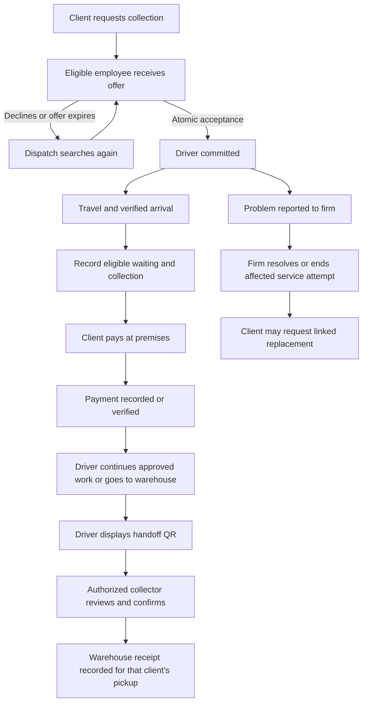

# Mohotew waste collection backend: canonical working plan

Version: 1.0, 2026-09-13. Status: backend and driver document onboarding deployed with bookings disabled; biodegradable receiving partner pending; transport rates unset.

This is the source of truth for backend planning. **Confirmed** means the owner explicitly decided it. **Proposed** means a technical or operational recommendation. **Open** means an answer is still required. New owner decisions supersede the earlier discovery draft; unanswered questions are never treated as approval.

Related specifications: [exception handling](EXCEPTION_HANDLING.md), [UI inspection evidence](reference-ui/README.md).

## 1. Confirmed operating contract

| Area | Owner decision, recorded 2026-09-13 |
| --- | --- |
| Platform | Separate Client and Driver Android apps, Flutter, shared hosted Supabase. iOS and the full regulator dashboard are on hold. |
| Signup and login | Clients sign up/login by email or phone. Drivers use ordinary Auth login, with separate signup application and document review before job access. Driver uploads a current Ghanaian driving license, clear face photo, current vehicle insurance and roadworthiness certificate; firm verifies them. Ghana Card is recommended/optional. See [driver onboarding contract](DRIVER_ONBOARDING.md). |
| Service area | East Legon, Accra, Ghana only. The actual operational boundary still needs an agreed polygon; do not invent one from the neighbourhood name. |
| Waste selection | Retain biodegradable and non-biodegradable in the service model. Coliba is designated for non-biodegradable waste only; a biodegradable receiving partner has not yet been secured. Keep biodegradable live booking/dispatch unavailable until one is configured. No mandatory client measurements, weights, volumes or collection units. |
| Employer and control | Drivers are employees. The operating firm regulates and controls jobs. Partnered independent collectors receive waste at warehouses; they are a distinct actor from employee drivers. |
| Receiving warehouse | Coliba Ghana / Lapaz Buyback Center, House No. 25, Dela Avenue, adjacent to the NHIS office, Abeka Lapaz, Accra. Non-biodegradable destination per owner. Approximate area reference: latitude 5.60601, longitude -0.24717, near Lapaz Total. This is not a verified vehicle-entrance pin. Hours, material restrictions and receiver accounts remain open. |
| Dispatch | Ride-hailing-style dispatch: a driver receives a job offer and may accept/claim it or decline before acceptance. After acceptance the driver cannot voluntarily refuse. |
| Interrupted service | A stranded client may book another driver. The backend must close or supersede the original service attempt safely before activating replacement work. |
| Routing | Custom routing rules using Google Maps, not the RouteLogic product. Urgent reports must not delay an already-promised pickup. |
| Full truck | A full truck goes to a partnered independent collector warehouse. The owner expects many trucks and does not want to design around fleet shortage now. Backend still tracks full/unloading state; shortage recovery stays in the exception specification. No unloading-wait promise to clients has been confirmed. |
| Price structure | GH₵1 booking fee + a dynamic client-to-warehouse transport fare based on distance, estimated travel duration, traffic and service category (biodegradable/non-biodegradable) + GH₵0.90/minute waiting after five free minutes from arrival. Dynamic rate values remain open. Time of day, vehicle class, separate demand/supply surge and weight fees are not selected pricing factors. |
| Transport rate readiness | The owner has no transport prices yet and explicitly asked to keep them open. Build configurable pricing interfaces; do not activate live transport quoting or invent rates. |
| Payment | The requesting client pays in cash, MTN MoMo or Telecel Cash before the driver leaves the client's premises. Supported mobile-money networks are confirmed; firm merchant accounts, receiving destination, direct APIs versus an integration provider, and production access remain open. |
| Final completion | A partnered independent collector scans one QR per client's pickup from the driver's app, then confirms receipt; the backend records that confirmation. A minimal authenticated receiver screen is approved now. One scan cannot complete the whole truckload. |

The public prototype is [CleanTrack](https://take-margin-40556501.figma.site/); the local project is named Mohotew. Final branding remains open. Ghana is now confirmed by the owner, independently of illustrative prototype data.

## 2. Current implementation boundary

The first backend implementation is now deployed: private PostGIS schema and RLS, client/driver command APIs, cash attestation, per-pickup receiver confirmation, Google Routes adapters and a scheduled dispatch worker. See [implementation, API contract, validation and activation requirements](BACKEND_IMPLEMENTATION.md) for the precise delivered boundary.

Live bookings remain disabled. Transport tariffs, service polygon, verified warehouse entrance, Google credentials, merchant integration and real staff accounts are not configured. Biodegradable remains unavailable. The exception specification continues to contain proposed work; deployment does not imply every exception or Android journey is implemented or field-tested.

## 3. UI requirements reconciled with the operating contract

| UI area | Required behavior |
| --- | --- |
| Client entry | Choose a supported authentication flow. A role-selection screen never grants driver, collector or firm privileges. |
| Request form | Biodegradable/non-biodegradable catalogue, with biodegradable labelled unavailable while its receiver is pending. Only serviceable categories may proceed to live quote/booking; enforce this on the backend too. Confirm pickup pin and access notes; no required measurement input. Photo requirement and mixed-category requests remain open. |
| Scheduled pickup wording | Ride-hailing suggests immediate requests, but future booking is not confirmed. Do not implement or promise scheduling until clarified. |
| Quote | Show GH₵1 booking fee, dynamic transport fare/basis, GH₵0.90/min waiting after five free minutes and quote validity before submission. Separate the proposed locked transport component from variable eligible waiting. |
| Searching/offering | Distinguish looking for a driver, an outstanding offer and an accepted booking. A visible offer is not a reservation until the server commits acceptance. |
| Tracking | Show assigned driver, ETA with freshness, arrival and collection progress; explain unloading delays if the selected dispatch policy permits them. |
| Pickup/payment | Show collection recorded, itemized amount due, payment pending/confirmed and receipt. Customer payment does not imply warehouse confirmation. |
| Rebooking | Offer a linked replacement after firm-authorized interruption or terminal failure; preserve history and prevent duplicate active service or accidental repeat payment. |
| Driver jobs | Replace ambiguous global CLAIM listings with offers authorized for the receiving employee. Separate declined/expired offers from accepted obligations. |
| Driver actions | Accept/decline before acceptance; travel, arrive, wait, collect and record cash/verify mobile money. After acceptance show Report problem instead of unrestricted Refuse. |
| Driver load/warehouse | Report operational load state, route to an eligible warehouse, display QR and track receipt confirmation. Do not force clients to measure waste to support this. |
| Collector handoff | Include the approved minimal authenticated, warehouse-scoped scan/review/confirm screen now, one QR per client pickup. The full regulator dashboard remains deferred; receiver screen placement is open. |
| Exceptions/support | Explain recoverable errors, payment uncertainty, failed collection and replacement progress. No empty support handler in the pilot. |
| Reports/profile/earnings | Dumping intake remains an open release-scope decision; urgent work cannot displace promises. AI detection, ratings, promotions, PIN changes and earnings must be implemented explicitly or hidden. |

The reference's login navigation, boolean photo capture, SVG map, fixed ETA and local state changes remain illustrative. See the preserved evidence rather than treating these labels as existing backend functions.

## 4. Core design: separate the events that have different meanings

There are at least three independently recorded outcomes:

1. **Collection:** the driver has physically picked up the client's waste.
2. **Payment:** the requesting client has paid the fare at the premises.
3. **Warehouse receipt:** an authorized independent collector has accepted the delivered waste by QR confirmation.

The final business completion event is warehouse confirmation, per the owner. Keep paid, collected and warehouse-confirmed timestamps distinct. A scan proves an authorized receipt assertion, not recycling, lawful disposal or measured composition on its own.

Normal departure from the premises requires payment confirmation. A technical system cannot physically restrain a driver: emergencies and disputed/unavailable payments require a firm-owned exception, outstanding-balance record and audit trail rather than fake paid status. The exact exception authority is a proposed policy to confirm before launch.

## 5. Dispatch and full-truck handling

Confirmed policy is firm-controlled ride-hailing-style offers. Bolt/Uber are analogies, not complete specifications to copy.

Proposed initial mechanics:

- Offer to one eligible employee at a time, ranked by road ETA within the approved area. Offer lifetime and total search timeout are configurable but unset pending field targets. Sequential offers are proposed; simultaneous broadcasting is not presumed.
- Acceptance checks driver identity, active employment/approval, shift, vehicle, offer expiry, order version and existing commitments inside one transaction. A unique active assignment constraint prevents two drivers winning.
- Decline or expiry before acceptance continues the search. No driver-initiated cancellation endpoint is available after acceptance. A driver may always report a genuine problem; only the firm can authorize ending/reassigning affected work.
- Proposed pilot constraint: one accepted client visit per driver at a time, while the truck may carry multiple already-collected loads awaiting warehouse receipt. This limits scheduling complexity; confirm before implementation.
- New urgent work cannot displace or delay an accepted promise. It uses genuinely available capacity or stays pending review.
- A full truck enters `unloading_required`, receives no new physically impossible collection commitment, and is directed to an eligible partner warehouse. It becomes collection-capable again only after the load reset is supported by a recorded handoff or authorized correction.
- Owner clarification: sufficient trucks are expected; do not make waiting for unloading the normal client flow. **Proposed implementation interpretation:** full trucks perform warehouse work; ordinary offers go to collection-capable employees. This does not guarantee another vehicle exists. If every truck is unavailable, return truthful search/unavailability and escalate rather than inventing a promise. The owner has not expressly resolved the original nearest-full-versus-farther-available ranking example; do not claim that edge-case policy is confirmed.
- If a truck unexpectedly fills during accepted work, report the interruption. Preserve custody of already-collected waste; determine unload/return or linked replacement through the firm. Never label the uncollected remainder complete.

The app does not require household measurements. Proposed internal load states are `available`, `nearly_full`, `full`, `unknown`, alongside waste compatibility and collector handoff records. Driver assessment/photo can support this. These are estimates, not a claim of measured capacity. Mixed categories, contamination and handling hazards require a defined acceptance catalogue; biodegradable/non-biodegradable alone is insufficient to distinguish batteries, medical waste, chemicals or bulky debris.

## 6. Pricing and payment contract

Confirmed billing currency is Ghana cedi (GHS). Confirmed structure, with the transport estimator still to be specified:

`fare_GHS = 1.00 + dynamic_transport_quote_GHS + 0.90 * billable_waiting_minutes`

`dynamic_transport_quote = pricing_rule(client_to_warehouse_distance, traffic_aware_estimated_travel_duration, service_category, tariff_version)`

Dynamic factors are confirmed; they are not a numeric tariff. The owner defines ride type as biodegradable/non-biodegradable service, and time as estimated travel duration only. Proposed implementation accounts for traffic through the traffic-aware duration estimate; it does not invent a second congestion multiplier. Coefficients/bands, floors/caps, quote expiry and final rule choice remain open. Do not invent a production rate or call Google routing output a selling price. Time-of-day and vehicle-class premiums are not selected; demand/supply surge is a separate unrequested factor.

Owner decision: no transport prices are available yet; keep this configuration open. A missing live rate rule returns `PRICING_NOT_CONFIGURED` and makes payable booking unavailable with a clear explanation. Never advertise GH₵1 as the full fare, silently substitute zero transport cost, or use test tariffs in a live environment. This does not block development of dispatch, pricing interfaces or sandbox/test journeys. No further price examples are required now.

Waiting starts with five free minutes when the driver arrives at the pickup point; chargeable waiting begins only afterwards. Do not backdate it to the first minute. Record verified arrival, client-ready/loading-start and payment events separately. Working interpretation of the owner's "No loading payment time should count" is that loading and payment are excluded; this interpretation was stated back to the owner and remains subject to correction. The waiting fee must not run through these excluded stages. Proposed calculation is `max(0, pickup_readiness_wait_seconds - 300)` with an explicit rounding rule. Stop charging when the client is ready for collection, not when the warehouse later confirms receipt. Repeated arrival events cannot restart/add overlapping chargeable sessions.

The owner resolved the denomination as 90 pesewas, GH₵0.90 per minute. For illustration, eight minutes of eligible pickup-readiness waiting gives three chargeable minutes and GH₵2.70 waiting, before any transport fare and the GH₵1 booking fee. Partial-minute rounding remains open; do not choose per-started-minute billing silently.

Required decisions before a payable booking can go live:

- Dynamic rate rules when the firm is ready to set them; quote expiry, any minimum fare, rounding and whether the two service categories have the same tariff. Category/time definitions, booking fee and waiting rate are confirmed.
- Client-to-warehouse is the only confirmed billable distance leg; driver-to-client travel is not part of that fee. A shared truckload makes per-client warehouse-distance attribution important. Never charge every client the entire multi-client route by default.
- Whether client-to-warehouse distance is a pre-agreed Google route or actual future travel. Proposed default is the quoted direct road route from that client's pickup point to the selected eligible warehouse. Warehouse selection and changed-destination treatment need adoption; no unilateral driver detour charge.
- Technical arrival validation, waiting rounding/cap and customer notice. Free first five minutes from arrival is confirmed; loading/payment exclusion is the stated working interpretation. Proposed free exclusions also include driver/firm/provider-caused delays. No GPS-only automatic billing.
- Payment is collected before departure, but warehouse travel happens afterwards. Proposed solution: lock the selected warehouse and quote-distance basis before payment; actual future route changes do not silently change the paid fare. Any later adjustment policy needs explicit agreement.

Proposed estimator workflow: select an eligible receiving warehouse under firm rules; obtain client-to-warehouse road distance and traffic-aware predicted duration; apply the active ride-type rule; return an itemized versioned quote; require acceptance before dispatch. If a duration component already includes traffic delay, do not add another traffic surcharge for the same minutes unless a separate disclosed pricing rule is explicitly adopted. Quoted journey time is distinct from pickup-readiness waiting; loading/payment time does not enter the waiting meter. On quote expiry or provider failure, produce a fresh accepted quote or an unavailable result, not arbitrary fallback pricing. Tests may use clearly labelled synthetic tariffs; live dynamic quoting stays disabled until the firm sets real pricing rules.

Store versioned fare rules and a quote snapshot with the request. Store monetary values in integer minor units and use decimal calculations with explicit rounding. A quote records distance source, applicable legs, tariff version and client acceptance. Driver apps cannot submit authoritative prices.

Cash proposal: driver attests the amount received; client receives an itemized receipt and can dispute. Cash received from the client and cash remitted by the employee to the firm are different ledger events. A digital cash record is not bank verification. Any cash-shortfall or adjustment needs an auditable firm decision.

Supported wallet networks are confirmed as **MTN MoMo** and **Telecel Cash**; cash remains supported separately. The integration path is still open: direct network APIs or an authorized payment integration supporting both networks. Network selection does not prove merchant onboarding, API entitlement or successful settlement. Firm-owned merchant/receiving accounts must be configured through authorized local setup; no credentials, wallet PINs or OTPs belong in chat or the mobile app.

Proposed payment record separates `wallet_network` from `integration_provider`, `merchant_account_id`, provider transaction reference and attempt state. Internal labels such as `mtn_momo` and `telecel_cash` are app-domain names, not assumed external API codes. Client chooses a supported network; validate wallet details through the selected integration, rather than assuming a number prefix proves its current network. Merchant destination comes from protected server configuration, never an arbitrary driver-supplied phone number.

A payment-request acceptance or screenshot is not proof of settlement. Verify final provider status, amount, currency, merchant and order reference server-side. Treat callbacks as untrusted notifications unless the integration supplies a verified authentication mechanism; reconcile by server query where needed. MTN documents asynchronous transaction status: [MTN status documentation](https://momodeveloper.mtn.com/content/html_widgets/v98wn.html). Telecel documents merchant payments through Telecel Cash, but that page does not establish developer API access for this firm: [Telecel Cash terms](https://support.telecel.com.gh/h/telecel-cash-services-terms-and-conditions/).

Each network needs its own sandbox/production validation through the chosen integration: authorization, failed/pending/successful payment, duplicate/delayed events, reconciliation and refund handling where supported. A passing MTN test does not validate Telecel. Disable a network's live payment initiation until its merchant configuration and verification path are ready; retain clear unavailable/pending states instead of assuming personal-wallet transfers are automatically verifiable.

Use stable payment-attempt references, idempotent submission, authenticated provider processing, durable event deduplication and reconciliation. Do not start a second debit just because a timeout occurred. Switching a pending mobile-money payment to cash can produce a late double payment; require an explicit reconciliation workflow. Overpayments, reversals, refunds and disputed cash stay recorded independently of warehouse receipt.

## 7. Warehouse QR handoff

Confirmed: the independent collector scans the driver's QR and then confirms. Merely opening the QR must never complete a job.

Owner-designated receiving destination: **Coliba Ghana / Lapaz Buyback Center, House No. 25, Dela Avenue, adjacent to the NHIS office, Abeka Lapaz, Accra**. Coliba receives **non-biodegradable collections only** in this platform's current plan. The owner is still seeking a separate biodegradable collector; do not route that category to Coliba as a fallback.

The owner supplied **latitude 5.60601, longitude -0.24717** as a general Lapaz Total area reference. Preserve it as `reference_latitude` / `reference_longitude` with `location_precision = approximate_area` and owner-supplied provenance. Keep separate verified `routing_latitude` / `routing_longitude` unset. The phrase "Coliba Lapaz Buyback Center Map" was supplied as link text without an actual URL; no Maps URL or Place ID has been verified. Area coordinates can orient a planning map, but must not drive final arrival geofences, billable-route endpoints or a claim of a verified receiving gate.

Earlier public-source review found different contact addresses on [Coliba's website](https://www.coliba.com.gh/about-us/) and [company LinkedIn page](https://gh.linkedin.com/company/coliba-recycling-services). The owner's specific Lapaz designation now resolves which site is intended; do not substitute another branch. Non-biodegradable is the owner-confirmed service assignment, not evidence that every material in that broad category is accepted. Receiving hours, excluded materials, vehicle access and authorized receiver accounts still need operational configuration.

Proposed warehouse record: owner-supplied display/address, approximate reference coordinate with precision/provenance, separately verified routing coordinate, receiving hours, non-biodegradable service assignment, material restrictions and authorized receiver memberships. Keep receiver readiness separate from category designation. Category readiness is checked during quote, booking and dispatch; changing the request payload or calling an API directly must not bypass it. The biodegradable category remains in the catalogue with `receiver_pending` availability, without a quote, payment attempt or driver offer. No demand/waitlist collection is implied. An approved route to Lapaz outside East Legon does not expand the East Legon client booking boundary.

Proposed secure flow:

1. Driver requests a handoff session for an approved warehouse and one eligible client's pickup. The server freezes that pickup's handoff scope/version. A truck may hold several such pickups, but each has a separate QR and receipt.
2. Server issues a short-lived random, single-use opaque token. Store its hash, expiry, issuing driver, target warehouse, manifest version and consumption state. No client phone, address, payment secret or elevated credential appears in the QR.
3. An authenticated collector scans the code. Backend checks warehouse membership, role, token validity, driver/session and manifest state before showing a minimal receipt summary. The driver cannot confirm their own delivery.
4. Collector explicitly confirms that pickup's handoff after inspection. Confirmation records receiver identity, facility, server time, handoff scope and acceptance evidence. A transaction consumes the token once and records accepted items and the corresponding pickup completion event only.
5. A repeated request with the same idempotency key returns the existing result. A reused QR with a conflicting receiver/payload is rejected. Rotating a QR revokes its predecessor without losing the handoff record.
6. If the collector rejects all or part, record accepted and rejected items separately; keep rejected waste in unresolved custody. Do not empty the truck or complete all linked pickups just because some items were received.
7. While offline, scanning may create a pending local submission, but final completion waits for server verification. Firm reconciliation is the recovery path for a genuinely completed physical handoff with unavailable devices/network.

One QR per client's pickup and the minimal authenticated collector screen are confirmed. A driver unload screen can list outstanding pickups and show their QR codes individually. Load status must not reset to empty after the first accepted QR: every carried pickup or unresolved item needs a receipt, transfer or authorized correction, plus an explicit load reconciliation when appropriate.

Open: whether multiple client loads are mixed; how a partially accepted or mixed pickup can be attributed; Coliba Lapaz receiving-entrance pin/hours/material restrictions, receiver accounts and maximum handoff delay; future biodegradable partner onboarding. If individual waste cannot be distinguished after mixing, a per-client QR does not establish physical attribution by itself. Agree tagged bags/segregated loads or an explicitly limited manifest-based receipt procedure. Partial collection/receipt needs a defined residual scope and subsequent handoff session without completing the same scope twice.

## 8. Proposed Supabase model and permissions

One Postgres/Supabase backend, with authorized reads, transactional business commands, private Storage, PostGIS, retryable jobs and a notification outbox. Google routing calls and mobile-money integrations remain server-side; restrict the Android Maps key separately.

| Entity group | Essential records / rules |
| --- | --- |
| profiles and protected roles | Client, employee driver, firm operator, warehouse receiver; no self-granted staff role. Final app packaging/auth method open. |
| employee drivers, vehicles, shifts | Employment/approval, assigned vehicle, capability, duty state, operational load assessment and active client commitment. |
| service areas and waste categories | Approved East Legon polygon; non-biodegradable mapped to Coliba Lapaz; biodegradable receiver pending. Server-enforced availability and material restrictions. No required client quantity. |
| pickup requests and location snapshots | Owner, category, pin/access notes, quote/version, booking state, linked replacement and pending policy decisions. |
| dispatch offers and assignments | Offered/declined/expired/accepted, expiry and assignment revision; one active winner per request. |
| collection attempts and wait sessions | Arrival, wait reason/start/stop, pickup evidence, interruption, collected/remaining scope, server/device timestamps. |
| fare rules, quotes and finalized fares | Versioned fee components, route-distance basis, eligible waiting and immutable adjustment history. |
| payment attempts, events, receipts, cash ledger | Amount/currency/reference, MTN/Telecel network distinct from integration provider and merchant, provider state, cash attestation, reversals, employee remittance and client dispute. |
| warehouses and receiver memberships | Coliba Lapaz address and approximate reference point recorded; non-biodegradable service assigned. Verified entrance stored separately; material restrictions, hours and receiver accounts remain to establish. No biodegradable receiver assigned. |
| loads, pickup handoffs, handoff items and QR sessions | Collected custody grouped by truck, one QR per client pickup, handoff versions, receiver confirmations, rejection/partial state and one-use token hashes. Partial scope must remain explicit. |
| routes and location state | Versioned pickup/warehouse route, stops and latest driver location with accuracy/freshness. |
| incidents, audit events, outbox and deduplication | Firm-owned recovery, authorized adjustments, idempotency, retry state and client notifications. |

Suggested independent state machines:

- Offer: `offered -> accepted | declined | expired | revoked`.
- Client visit: `searching -> accepted -> en_route -> arrived -> collected`, with explicit failed/cancelled/interrupted paths and partial-collection records if allowed.
- Payment: `due -> pending -> paid`, with `failed`, `disputed`, `reversed`, `refunded` and outstanding-balance records. Allowed transitions follow provider facts and firm adjustments, not a simple freely editable status.
- Handoff: `awaiting_delivery -> presented -> confirmed | partially_confirmed | rejected`; presentation is not confirmation.
- Client display: collected/paid/awaiting warehouse confirmation, then completed when the applicable received scope is confirmed. A later payment reversal can reopen the financial issue without deleting the physical handoff.

Clients read their own orders and receipts. Drivers read current authorized client visits and their custody obligations; prior reassignment revokes unrelated private/live access. Collectors see only warehouse-scoped manifest data needed to receive waste. Firm operator actions need specific permissions and an actor/reason audit trail. No staff receive the Supabase service key through an app.

All mutable commands use actor authorization, idempotency, version/state checks and database constraints. Commit the business change, audit event and notification intent together. External calls happen outside database locks. PostgreSQL supports row locking for these concurrency boundaries: [locking documentation](https://www.postgresql.org/docs/current/explicit-locking.html). User-called Edge Functions must authenticate the caller and enforce authorization: [Supabase function authentication](https://supabase.com/docs/guides/functions/auth).

Use private object storage and signed access; no public bucket for pickup photos or identity documents. Define retention and deletion rules for GPS, evidence, financial records and accounts. Optional quantities collected internally must have explicit units; missing client measurements must never become a fabricated zero.

## 9. Google Maps routing and availability

Use PostGIS containment for the owner-approved service polygon and Google road estimates for short-listed candidates. Never infer travel time from straight-line distance alone. Validate category compatibility, promise preservation, receiver opening hours and unload routes. Warehouses may require travel outside East Legon; approval of those destinations is separate from allowing client bookings outside the service area.

Compute Routes supplies paths/estimates; Route Matrix compares travel times. Those services do not implement the firm's offer/acceptance, payment or warehouse-custody rules. See [Routes](https://developers.google.com/maps/documentation/routes/compute-route-over) and [Route Matrix](https://developers.google.com/maps/documentation/routes/compute_route_matrix).

Provide a confirmed pickup pin and access instructions, manual correction when GPS fails, ETA freshness and a sensible no-route response. Replan only on meaningful events: accepted job, interruption, full truck, approved reroute, warehouse rejection/closure. Do not move an accepted promise to accommodate an urgent report. Set provider budgets/quotas after pilot volume is agreed.

Proposed navigation starts by opening Google Maps for the approved next destination. Embedded navigation remains a later decision. Verify local road access and the selected Google capabilities for actual collection vehicles before promising truck suitability.

## 10. Exception handling and operational ownership

[EXCEPTION_HANDLING.md](EXCEPTION_HANDLING.md) specifies triggers, backend responses, customer/driver recovery and accountable owner across authentication, booking, dispatch, physical service, waiting, cash/mobile money, routing, warehouses, QR, offline operation and staff controls.

These are proposed recovery rules except where marked confirmed. They must become acceptance tests before implementation is called complete. The firm owns unresolved service/payment/custody incidents. A full regulator dashboard can wait; secure firm operations and receiver confirmation cannot be omitted from a functioning pilot. No unlogged direct database edits as the routine recovery mechanism.

Do not claim every possible failure is known. The catalogue covers the identified launch features and must expand with provider integration findings and pilot incidents.

## 11. Delivery order and release gates

| Stage | Deliverable | Required evidence |
| --- | --- | --- |
| 0. Set remaining contract | Pricing activation when ready, waiting rounding, quote commitment, receipt attribution, East Legon boundary, Coliba entrance/material restrictions, MTN/Telecel merchant integration | Decisions recorded; no fabricated price, polygon or completion semantics. Biodegradable capability remains unavailable pending its own receiver; transport rates remain unset. |
| 1. Foundation | Read-only hosted audit; dev/staging; reproducible migrations; Auth/roles; private Storage; firm/receiver permissions | Owned reads and forbidden writes tested; no self-approval or exposed privileged key. |
| 2. Booking and dispatch | Category/pin/quote, offer/decline/expiry, atomic acceptance, arrival and problem reporting | Two acceptance requests yield one assignment; client may safely create a linked replacement after failure. |
| 3. Collection and payment | Recorded pickup, defined waiting meter, fare snapshot, cash receipt, mobile-money settlement/reconciliation | Duplicate commands/callbacks cannot duplicate fares or debits; payment timeout stays pending; normal departure follows payment. |
| 4. Warehouse completion | Full-truck route, per-client pickup QR, receiver access and confirmed handoff | Driver cannot self-confirm; scan alone does nothing; one pickup's QR cannot complete other pickups; replay/partial rejection/offline cases preserve custody. |
| 5. Field reliability | Live ETA, background/offline behavior, push, provider failures and firm recovery procedures | Two real Android accounts, actual pickup and warehouse journeys, denied permissions and network loss tested. |
| 6. Controlled East Legon pilot | Defined staff, capacity, service hours, cost monitoring and support ownership | Agreed completion/payment/handoff targets, exception drills and a restore rehearsal. |

Use Google route estimates in Stage 2 if pricing depends on distance. Implement QR/payments as required core scope, not optional afterthoughts. Do not schedule production launch until the entire paid-pickup-to-warehouse chain is demonstrated. Milestones are dependency order, not time/cost promises.

## 12. Decision register

| ID | Status as of 2026-09-13 | Remaining question |
| --- | --- | --- |
| D01 Service | PARTLY CONFIRMED | East Legon only; two modelled categories, no measurements. Non-biodegradable assigned to Coliba; biodegradable receiver pending and live service unavailable. Need boundary, material restrictions/mixing, customer segment and pilot size. |
| D02 Dispatch | PARTLY CONFIRMED | Employee offers can be declined before acceptance; no voluntary refusal after. Need offer/search timeouts, immediate vs scheduled, and one-active-visit policy. |
| D03 Routing/ownership | CONFIRMED | Custom Google Maps logic; firm employs and controls drivers; independent collectors receive at warehouses. |
| D04 Price/payment | PARTLY CONFIRMED; RATES INTENTIONALLY OPEN | GH₵1 booking; client-to-warehouse fare based on distance, traffic-aware estimated travel duration and biodegradable/non-biodegradable service; five free minutes then GH₵0.90/min waiting; cash, MTN MoMo or Telecel Cash before departure. Transport prices intentionally unset. Rounding/quote commitment, merchant accounts/integration path, refunds and remittance remain open. Loading/payment time interpreted as excluded. |
| D05 Dumping reports | OPEN | First-release inclusion and funding/review owner. Confirmed urgent work cannot delay promised pickups. Proposed defer/hide intake until decided. |
| D06 Completion | PARTLY CONFIRMED | Coliba Lapaz, House No. 25 Dela Avenue adjacent NHIS, for non-biodegradable; approximate reference 5.60601, -0.24717 only. Per-client QR/receiver screen confirmed. Need exact entrance, hours/material restrictions, accounts, pickup evidence and partial receipt rules. Biodegradable partner pending. |
| D07 Full truck | PARTLY CONFIRMED | Full truck goes to warehouse; owner expects sufficient trucks and de-emphasizes shortage. Proposed normal flow uses collection-capable trucks, with no-driver fallback. Original priority edge case not expressly settled. |
| D08 Exceptions | PARTLY CONFIRMED | Firm controls jobs; stranded client can rebook. Detailed proposed catalogue needs adoption, escalation contacts, response targets and emergency authority. |
| D09 Account model | OPEN | One app/two experiences or separate apps; staff invitation, authentication/recovery method and role combinations. |
| D10 Tracking/offline | OPEN | Allowed tracking visibility, duty hours, offline duration, location freshness thresholds and retention. |
| D11 Providers/budget | PARTLY CONFIRMED | MTN MoMo and Telecel Cash networks selected. Direct APIs versus integration provider, firm merchant setup, Google/SMS access, expected jobs/day and operating budget remain open. Credentials stay in authorized local/server setup. |
| D12 Pilot gates | OPEN | Agreed targets for pickup timeliness, payment reconciliation, handoff age, failed jobs and support response. |

Recorded: service categories define ride type, time is estimated travel duration only, waiting is GH₵0.90/min after five free minutes, QR is per-client pickup, Coliba Lapaz receives non-biodegradable waste only, and MTN/Telecel are supported wallets. The approximate Lapaz reference is recorded without promoting it to a verified entrance. Biodegradable receiving partner and transport prices remain intentionally pending; do not repeatedly request a partner or rates before the owner has them. Firm merchant account readiness, exact routing gate, service boundary and remaining exception/evidence rules are still open.

## 13. Revision history

- 0.1 (2026-09-12): UI inspection, initial architectural proposal and unanswered discovery register.
- 0.2 (2026-09-13): Incorporated owner's East Legon, two-category/no-measurement, employee dispatch, on-site cash/MoMo, fare structure, non-preempting urgency and warehouse QR decisions. Replaced optional payment/warehouse scope with required core flows. Added an exception specification; unresolved interpretations remain explicit.
- 0.3 (2026-09-13): Recorded client-to-warehouse billing, GH₵1 booking fee, five free minutes from arrival, stated loading/payment exclusion interpretation and approval of minimal receiver screen. Flagged ambiguous waiting denomination and unanswered distance rate/QR scope; recorded the expectation of a large fleet without assuming guaranteed availability.
- 0.4 (2026-09-13): Resolved waiting rate as GH₵0.90/min and QR as one per client pickup. Replaced a flat per-kilometre assumption with the requested dynamic distance/time/traffic/ride-type estimator, whose actual pricing rules remain open. Added per-pickup receipt isolation and truck-load reconciliation.
- 0.5 (2026-09-13): Owner explicitly deferred transport price values. Defined unconfigured pricing behavior and separation of synthetic test tariffs from live payable booking; ride-type/time clarification remains pending.
- 0.6 (2026-09-13): Owner confirmed biodegradable/non-biodegradable service as ride type and estimated travel duration only as time. Proposed traffic-aware duration as the traffic input without a duplicate congestion fee; numeric tariffs remain intentionally open.
- 0.7 (2026-09-13): Owner designated Coliba Ghana, Dela Avenue and MTN/Telecel mobile money. Preserved destination choice while flagging entrance/category verification from differing public addresses and plastic-focused service descriptions. Separated wallet networks from merchant/API integration readiness.
- 0.8 (2026-09-13): Owner specified House No. 25 Dela Avenue adjacent NHIS, Abeka Lapaz, with approximate area reference 5.60601, -0.24717. Assigned non-biodegradable to Coliba and kept biodegradable service unavailable pending its own collector. Separated approximate reference coordinates from verified routing coordinates and added category-availability enforcement.
