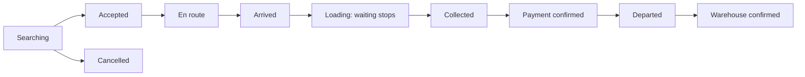

# Mohotew frontend: canonical implementation plan

Version 0.1 — 2026-09-15. Status: proposed frontend baseline grounded in the checked-in backend. Open owner decisions remain open; this document does not authorize live bookings.

Implementation update: [frontend gap delivery and owner actions](FRONTEND_GAPS_IMPLEMENTATION.md) records deployed reads, ETA and foreground updates, with tested Flutter adapters. Its delivery status supersedes the corresponding “proposed extension” rows below; UI and real provider integration remain separate.

## 1. Scope and evidence

Build separate Client and Driver Android applications using Flutter and the existing Supabase backend. Include the already-approved minimum receiver workflow. Decide how firm staff will operate the pilot before release. iOS and the full regulator dashboard remain deferred.

Evidence inspected: [backend plan](BACKEND_PLAN.md), [implementation contract](BACKEND_IMPLEMENTATION.md), [driver onboarding](DRIVER_ONBOARDING.md), [health review](BACKEND_HEALTH_REVIEW.md), the eight SQL migrations, Edge entry points, and `lib/backend/waste_backend.dart`. The Flutter entry screen is currently a placeholder. Deployment and test results in existing documents are historical evidence; hosted services and device journeys were not revalidated for this planning exercise.

Use Bolt as a reference for simple request flows, upfront price presentation, tracking and separate driver work. Bolt's published rider flow describes destination selection, service selection and driver tracking; its separate driver product supports driver work. Features vary by market. These sources are not an inspection of a signed-in Ghana Bolt journey: [Bolt rider listing](https://play.google.com/store/apps/details?id=ee.mtakso.client), [Bolt driver listing](https://play.google.com/store/apps/details?id=ee.mtakso.driver), [driver app support](https://bolt.eu/en/support/sections/115000658333/).

**Proposed design interpretation:** a map with a bottom action sheet, short forms, clear prices and one primary action per stage. Use Mohotew's own identity pending branding clarification. The existing CleanTrack prototype is reference evidence, not a functional specification.

### Confirmed boundaries

- East Legon pickup service; approved warehouse destination may be outside East Legon.
- Immediate collection is the implementation baseline. Scheduling has no current backend contract.
- No mandatory client weight, volume or unit measurements.
- Non-biodegradable service requires operational readiness. Biodegradable remains unavailable pending a receiver.
- Employees receive private offers; they can decline before accepting, then report problems to the firm rather than cancel freely.
- GH₵1 booking fee plus server-quoted transport, plus GH₵0.90/minute eligible waiting after five free minutes. Numeric transport rates and waiting rounding remain unapproved/unset.
- Payment occurs at pickup before normal departure. Warehouse confirmation is a later, separate event.
- One QR represents one client's pickup, even when the truck carries several pickups.

### Product surfaces

| Surface | Main navigation | Purpose |
| --- | --- | --- |
| Client Android | Home, Collections, Account | Request, follow, pay for and review own collections |
| Driver Android | Work, Load, Account | Receive offers, perform a visit, reconcile carried pickups and documents |
| Receiver, proposed small staff web surface | Sign in → Scan → Review → Confirm | Warehouse-scoped receipt; no public role signup |
| Firm, proposed minimum staff web surface | Applications, Active work, Incidents | Review/provision drivers and resolve real operational problems |

Receiver placement and firm interface delivery are open. Their necessary work cannot disappear because the full dashboard is deferred.

## 2. Client journey, in implementation order

| Step / screen | User experience and primary action | Contract and acceptance condition |
| --- | --- | --- |
| C01 Startup | Restore session, show startup failure with Retry, fetch service availability | Supabase initialization, `wm_catalog`; distinguish network failure from bookings disabled |
| C02 Welcome | Brief service explanation; Create account / Sign in | No shared Client/Driver role picker; app identity is explicit |
| C03 Account creation | Email or phone, password, verification, resend/error feedback | Supabase Auth; existing contract is password authentication with verification, not assumed Bolt-style passwordless OTP |
| C04 Verification / recovery | Complete verification; recovery path for chosen Auth method | Real email/SMS delivery and Android return links require integration tests; no unsupported phone reset promise |
| C05 Profile | Full name and Continue | `wm_onboarding_command`: `client.register`; do not enter booking before enrollment succeeds |
| C06 Location introduction | Explain why pickup location helps; request when needed | Denial leaves manual address + map pin available; client has no background-location need |
| C07 Home | Pickup map, Request collection action, current collection card; unavailable service explanation | Catalogue controls capability. Empty map does not show invented nearby trucks |
| C08 Pickup location | Move pin, enter address and access note; Confirm pickup | Coordinates required. Address search/geocoding is additional integration; manual pin works without autocomplete. Server validates serviceability |
| C09 Waste category | Choose supported category; explain unavailable options | Catalogue `enabled`, `receiver_pending`, `pricing_ready`; no mandatory quantity or client photo added |
| C10 Quote review | Itemized transport + booking fee; waiting explanation; expiry; Request collection | `wm-quote`; accept only returned price. Expired quote requires explicit review of replacement quote. GH₵1 is never advertised as total fare |
| C11 Searching | Honest search status; Cancel while searching | `booking.submit` with persisted command key; `wm_get_order`; `booking.cancel` only in searching state. No fabricated countdown to guaranteed driver |
| C12 Driver assigned / approaching | Driver card when supported, pickup map, latest position/freshness, problem action | `wm_tracking` and order read; current API lacks card identity and ETA. Address those gaps or show a reduced truthful screen |
| C13 Arrived / waiting | Arrival time, free period and estimated eligible waiting; clear loading status | Server `arrived_at` and `ready_at`; local timer is presentation only. Do not start waiting from phone proximity |
| C14 Collected / payment | Server amount due and payment status; cash instructions or enabled wallet | Cash is recorded by driver, not a client “I paid” button. MoMo/Telecel initiation currently unavailable |
| C15 Awaiting warehouse receipt | Collection and payment summary; warehouse receipt pending | After departure, use a timeline. Tracking RPC does not expose warehouse-leg tracking |
| C16 Completed / detail | Separate collected, payment and warehouse receipt facts | Final completion only when `warehouse_confirmed_at` exists; receipt is a collection/payment record, not proof of recycling |
| C17 Collections / account / help | Paginated history, detail, supported name edit, sign out, working problem report | `wm_list_orders`, `wm_get_order`, `profile.update`, `incident.report`; deletion, detailed receipt export and support conversations need further contracts |
| C18 Failed visit / replacement | Explain failure; offer a reviewed new quote and linked replacement | Only after server-authorized failure; `booking.submit` with `replacement_of`. No silent transfer/refund of earlier payment |

Before bookings are enabled, these screens may be developed using explicitly labelled test fixtures. Production Home must show unavailable service, not a simulated successful booking.

## 3. Driver onboarding and work journey

### Onboarding

1. **Welcome and authentication:** separate Driver identity, email/phone and password, verification, sign in and recovery. Explain that account creation does not authorize collection work.
2. **Restore progress:** read `wm_account_access` and `wm_my_driver_application` after sign-in and on return. Do not require a repeat application on every login.
3. **Personal and vehicle details:** full name and plate required; optional supported identity/address/emergency/make/model fields. Save using `application.save`. Keep optional fields optional until the owner changes the requirement.
4. **Document checklist:** Ghana driving licence, face photo, vehicle insurance and roadworthiness required; Ghana Card optional. Show expiry, upload progress and validation beside each item.
5. **Real upload:** `document.reserve` → upload to returned private path with `upsert: false` → `document.finalize`. Carry the latest application version after each step. PDF accepted where supported, never for face photo; enforce 10 MB and supported MIME types. A progress animation is not uploaded evidence.
6. **Review and submit:** display the actual saved dossier, then `application.submit`. Missing/current-document validation comes from server as well as form checks.
7. **Application status:** draft, submitted, changes requested, rejected and approved. Display returned review reason, affected documents and permitted next action. Approval and operational provisioning are separate: “Approved—awaiting firm activation” is a real state.
8. **Renewal:** `application.reopen` when allowed; upload replacements and resubmit. Never overwrite approved documents. Expired/revoked documents block new jobs but must not hide existing work/custody resolution from an otherwise authorized driver.

### Operational screens

| Step / screen | Interaction | Contract / constraint |
| --- | --- | --- |
| D01 Work home | Offline/online control; eligibility, connection and GPS status | `driver.availability`, account access. Add own-driver status read for authoritative online/load/vehicle restoration |
| D02 Permissions | Explain location when going online; notifications when work alerts are introduced | Foreground, screen-off and background behavior need physical Android validation. Offer reception is foreground-only until delivery is built |
| D03 Offer sheet | Coarse area, category, server expiry, Accept / Decline | `wm_my_offers`, `offer.accept` / `offer.decline`; API exposes no exact address, earnings or approach ETA before acceptance |
| D04 Accepted job | Pickup address/access note; Start journey; Report problem | `wm_get_order`, `driver.travel`; no unrestricted cancellation after acceptance |
| D05 Navigate / arrive | Open navigation to confirmed pickup; Arrived | `driver.location`, `driver.arrive`; fresh nearby GPS required. External navigation does not advance order state |
| D06 Waiting | Free period then eligible waiting estimate; Start loading | `driver.start_loading` stops billable waiting; loading/payment time excluded |
| D07 Collection evidence | Capture, preview, retake before upload, upload and confirm collected | `evidence.reserve` → private upload → `evidence.finalize` → `driver.collect`; finalized photo required |
| D08 Payment | Show exact server amount; explicit “Cash received” confirmation | `payment.cash`; no editable fare, driver-side discounts or invented earnings. Mobile-money status must come from a future provider-backed contract |
| D09 Leave pickup | Depart action after confirmed payment | `driver.depart`; if blocked, report problem and await firm resolution. Safety exception is not “paid” |
| D10 Load | List departed pickups still in custody; report nearly full/full/unknown | `driver.load`; driver cannot reset to available. Current history read can seed list but authoritative active-work read is needed |
| D11 Warehouse destination | Warehouse details and navigation | `wm_driver_destination`; never navigate to approximate catalogue coordinates as a verified entrance |
| D12 Per-pickup handoff | Select eligible pickup, show expiring QR, observe receipt outcome | `handoff.issue`; collected and departed required. Fresh issue rotates token; replay can return `refresh_required` |
| D13 Reconciled load | Completed/pending pickups distinguished; wait for firm reset where needed | Receipt alone does not automatically set truck available; firm uses `operator.load_reset` after all obligations clear |

An employee can carry several completed pickup visits awaiting receipt while handling at most one active client visit under current backend constraints. Work and Load must therefore remain separate. Signing out, going offline or losing permission never cancels accepted work; explain outstanding obligations and provide the agreed escalation path.

## 4. Receiver and firm workflows

**Receiver:** authenticate → verify warehouse access → camera permission → scan one QR → `wm_preview_handoff` → review returned category/pickup/warehouse → explicitly confirm, partially receive or reject → `handoff.confirm` → server acknowledgment. Partial/rejected outcomes require a reason and leave custody unresolved. Scanning itself does not complete a pickup. Handle wrong warehouse, expired token, repeated scan and uncertain confirmation. A driver cannot self-confirm.

**Firm minimum:** application queue and private document review; record review reasons; approve application then provision employee/vehicle; monitor active collections, failed dispatch and incidents; fail a pre-loading visit when authorized; record exceptional departure/waiting reduction where allowed; reconcile cash and reset truck load. Use existing privileged RPCs under staff identities. Initial privileged staff bootstrap stays a trusted server operation.

If a technical operator will perform this work during a small pilot, document a runbook and named duty coverage. Do not substitute a decorative dashboard for operational coverage. Payment ledger views, receipt outcome detail and some staff reads need extensions before complete staff screens can be promised.

## 5. Authoritative state and presentation



This diagram is the normal user journey, not the database enum. Payment, departure and warehouse receipt are separate fields/records. The database order states are `searching`, `accepted`, `en_route`, `arrived`, `loading`, `collected`, `cancelled`, `failed`. In particular, warehouse-confirmed orders can still have `state=collected`.

Render from order state + timestamps + payment status + access permissions. Show exceptions outside the happy path. Never create a local `completed=true` toggle. Refresh after every mutation and on foreground return. If an unknown future state arrives, display safe status with refresh/support rather than guessing the next command.

## 6. Frontend architecture

### Application packaging

Propose one Flutter repository with Client and Driver entry points and Android product flavors, distinct application IDs, names, icons and permission manifests. This produces two separately installable apps while sharing code. Keep environment configuration separate from app role. Use a separate staff entry point if a Flutter web staff surface is chosen.

No full repository restructuring is required at the first screen. Evolve the current layout as follows:

```text
lib/
  main_client.dart
  main_driver.dart
  app/                  bootstrap, environment, session gate, routers
  core/
    design/             colors, typography, spacing, shared controls
    network/            transport/error classification
    persistence/        command journal, scoped drafts
    platform/           location, camera, navigation, notifications
  backend/
    waste_backend.dart  existing RPC/Edge adapter, retained
    models/             typed API response models
    repositories/       auth, account, orders, offers, uploads, handoffs
  features/
    auth/
    client/             enrollment, home, booking, tracking, history
    driver/             application, work, pickup, payment, load
    account/
    support/
test/
integration_test/
```

Data flow: **View → view model/controller → repository → WasteBackend / Auth / private Storage**. The server owns fares, eligibility and transitions. Repositories own refresh, parsing and reconciliation; widgets own display and input. This is a deliberately small adaptation of [Flutter's architecture guidance](https://docs.flutter.dev/app-architecture/guide). Android flavors are a supported packaging mechanism: [Flutter flavor documentation](https://docs.flutter.dev/deployment/flavors).

Start with Flutter's built-in `ChangeNotifier`/`Listenable` and constructor injection, already adequate for the scaffold. Use one guarded routing approach; select a routing package during foundation work if verified deep-link requirements justify it. Do not combine several competing state libraries. Choose and pin storage/maps/camera/QR/notification dependencies after a small Android compatibility check, not from assumed versions.

### Routing and restoration

- Startup gate: initialized → session valid → access checked → enrollment/application status → authorized app shell.
- Deep links and notification taps are navigation hints: authenticate and fetch the referenced resource before opening it.
- Restore accepted visit and outstanding custody independently of historical order pagination. The current API does not yet provide a complete active-work snapshot.
- On logout/account change, discard visible private caches and isolate unresolved command records by user. A new user must never replay another user's commands.
- Suspended accounts follow an access-restricted path with operational escalation. Document-expired but still authorized drivers retain resolution access for existing obligations.

### Durable commands and connectivity

`WasteCommand.toJson` supports serialization; it does not implement a durable queue. Build a device command journal with user ID, endpoint, key, exact payload, timestamps and outcome (`pending`, `uncertain`, `acknowledged`, `rejected`). Save before sending.

On timeout, reuse the exact command key and payload to discover/replay the result. On `VERSION_CONFLICT`, refresh, explain changed state and ask the user to act again where required; do not silently manufacture a new action. Disable duplicate taps while a command is unresolved.

Allow local drafts and pending uploads, but require server acknowledgment for acceptance, payment, departure and receipt. Expired offers/quotes are not offline reservations. QR tokens stay transient and out of logs/URLs; token-bearing confirmation payloads require protected short-lived persistence and removal after reconciliation. Never store identity documents in an unprotected general cache.

Driver GPS needs persisted monotonically increasing sequence numbers and server reconciliation after reinstall/device change. Do not blindly replay stale GPS samples. A server status read or explicit location-session contract is needed because the current API neither returns nor resets the stored sequence safely for the app.

### Updates and maps

- First integration: lifecycle-aware foreground polling through existing read RPCs, refresh after mutations and pull-to-refresh. Proposed starting intervals: 3–5 seconds for active offers/tracking, slower for passive views, backoff on failures; measure fleet cost before adoption.
- Production background offers need token registration, authorized event delivery, push retries and Android notification handling. The existing worker does dispatch, not proven push delivery.
- Realtime, if introduced, must use scoped authorization; the private `wm` schema is not an invitation to subscribe directly to all tables.
- Map SDK displays authorized coordinates. Google Routes server key never ships in Android; any client map key has separate app/API restrictions.
- Start navigation through an installed maps app to the server-authorized point. Embedded turn-by-turn, truck-access guarantees and optimization of multi-stop warehouse routes are separate work.
- No ETA from straight-line distance or fixed prototype text. Add a server ETA contract with calculation time or omit ETA. Mark stale coordinates and stop presenting them as live.

## 7. API gaps to close before promising corresponding UI

All entries below are proposed extensions, not existing endpoints.

| Priority | Gap found in current contract | Needed decision/delivery |
| --- | --- | --- |
| P0 | No authoritative own-driver operational snapshot | Read online/load/vehicle, location sequence and eligibility reasons; restore correctly after restart |
| P0 | History alone cannot reliably restore all active visits/custody | Scoped active-work query for client/driver; stable pagination for history. Existing timestamp-only cursor can skip equal-timestamp rows |
| P0 | Assigned-driver card fields absent | Scoped display name/photo/plate and agreed contact mechanism; do not expose private application documents |
| P0 for staff surface | Account access omits receiver/operator capabilities | Safe staff access bootstrap and warehouse membership read; server still validates each action |
| P0 for receipt UI | Order read omits detailed partial/rejected handoff outcomes | Scoped receipt status/reason read and uncertain-confirmation recovery; avoid leaving user on “pending” forever |
| P0 for pilot support | Report creation exists, full support experience does not | Named contact/escalation workflow; optional own-incident status read. Do not promise chat or instant response |
| P0 for unattended driver work | No delivered background offers or tested background GPS | Notification registration/delivery and Android lifecycle integration; otherwise explicitly supervised foreground test only |
| P1 / omit until ready | Tracking contains no ETA, route geometry or public contact card | Server route/ETA endpoint and authorized contact policy; map coordinate display can proceed separately |
| P1 / owner pilot decision | Mobile money hard-fails as unconfigured | Merchant/provider integration, wallet input contract, initiation/status, callbacks and reconciliation; no fake success screen |
| P1 | Payment details insufficient for full receipts/remittance interface | Scoped method/reference/timestamps and staff ledger read; do not label gross cash collections as driver earnings |
| Before release | Account deletion, support configuration and consent policy incomplete | Owner policy plus safe account-request workflow and required records; no inert controls |

Other integrations: email/SMS delivery, map display/search, actual private file bytes, camera/QR and crash reporting. Operational activation separately requires approved tariffs and rounding, Google routing access, verified pickup boundary/warehouse entrance, receiving rules and staffed accounts. Existing health documents report bookings disabled; the app must always consult current catalogue/server responses.

## 8. UI system and failure behavior

Proposed visual rules: light neutral surfaces, strong primary action color from the chosen brand, readable map overlays, consistent 8-point spacing and large touch targets. Driver controls prioritize quick reading and deliberate confirmation. Use words/icons with color; support TalkBack, text scaling, keyboard avoidance and small Android screens. Externalize strings; English is a provisional baseline, additional languages need owner priority.

Reusable components: pickup selector, service card, fare breakdown, status timeline, offer sheet, permission explainer, document tile, evidence uploader, connection banner, action confirmation, incident form and expiring QR panel.

Every screen has loading, empty, unavailable, permission-denied, offline, error and success behavior where applicable. Every visible action has a working outcome or a clear disabled reason.

| Trigger | Required experience |
| --- | --- |
| Bookings/pricing/receiver unavailable | Clear explanation; disable submission; preserve draft |
| No accepted driver yet | Keep honest searching status, searching-only cancellation and configured escalation; no invented SLA |
| Quote or offer expired | Refresh; user reviews new quote/offer rather than auto-accepting |
| GPS stale or inaccurate | Explain and request fresh location; never auto-arrive |
| Upload interrupted | Recover reserve/upload/finalize status; no false “uploaded” tick |
| Payment uncertain | Show checking/pending; prevent fresh competing payment command |
| App killed after accepted command | Restore journal and reconcile server result before new action |
| Full truck / unresolved custody | Block new-work assumptions; retain pending load and firm contact |
| Driver approval expires | Restrict new jobs; preserve authorized in-progress resolution |
| QR expired/replayed/rejected | Refresh/reconcile; full completion only on server-confirmed receipt |

## 9. Build sequence and exit criteria

Each stage produces working screens plus evidence. Review screen groups at the listed checkpoints; estimates should follow foundation work and answers to the open scope decisions.

| Stage | Concrete deliverable | Exit criterion |
| --- | --- | --- |
| 0. Contract and design baseline | Adopt this plan, record open decisions; wireframes for Client welcome/quote/tracking and Driver onboarding/offer/pickup | Each control mapped to an API, integration or explicit gap; visual direction reviewed |
| 1. Foundation | Two Android flavors, shared theme, typed adapter, routing gates, scoped command journal, test fixtures | Both apps install together; startup failure/session restore/uncertain command tests pass |
| 2. Authentication and enrollment | C02–C06 and complete driver application/status/renewal flow | Real verification and private document bytes tested; applicant cannot enter unauthorized work; review checkpoint |
| 3. Minimum staff and operational reads | Receiver access, review/provisioning workflow, own-driver and active-work reads | A test driver can be reviewed/provisioned and resume work correctly; named staff workflow exists |
| 4. Client request | Home, pickup pin, category, quote, submit/search/cancel | Disabled production capabilities honest; configured test booking creates once; duplicate/expired/error paths pass; review checkpoint |
| 5. Driver visit | Availability/GPS, offer, navigation, arrive, loading, evidence, collect | Full authorized lifecycle works on Android; stale GPS, expiry, decline and accepted-work problem paths pass |
| 6. Payment and receipt | Cash flow or integrated wallet per owner choice, depart, Load, QR, receiver confirmation | Client payment and warehouse receipt separate; two pickups require two receipts; partial/rejected/replay cases pass |
| 7. Operational resilience | History, support, notification delivery, background location, restored drafts/commands | Screen-off, killed-app, denied permissions, network loss and token renewal exercised on physical devices |
| 8. Controlled field pilot | Configure real operational prerequisites; end-to-end client/driver/receiver run and staff recovery drill | Agreed fares correct, no duplicate booking/payment, documented custody and receipt, operational owner signs off activation |

First implementation slice after plan review: the shared visual system, two app identities, startup/session gates, Client welcome and Driver welcome. Next, finish real authentication/enrollment before booking UI integration. Do not begin with a large decorative dashboard.

### Validation by responsibility

- Unit/contract: typed response parsing, null/unknown states, price formatting in integer pesewas, screen-state derivation, retry keys, GPS sequence recovery.
- Widget: form validation, optional Ghana Card, capability-based controls, text scaling, critical action confirmation and documented error states.
- Integration: actual Auth verification, Storage bytes, offer/visit lifecycle, cash or wallet reconciliation, QR confirmation and restart restoration.
- Device: both Android apps, map/GPS/camera, permission revocation, background/screen-off behavior, poor network and battery restrictions.
- Backend regression when APIs change: existing Node/PGlite and Deno checks plus meaningful simultaneous-acceptance tests. Existing sequential tests are not concurrency evidence.
- At each implemented slice run `flutter analyze` and relevant `flutter test`; before pilot build both Android artifacts and run journeys on devices. Passing analysis is not proof that an APK launched.

Do not perform live charges or activate customer bookings as a side effect of development validation.

## 10. Decision register

| Decision | Status / proposed direction | What depends on it |
| --- | --- | --- |
| Separate Client/Driver Android apps | Confirmed in existing owner record | Packaging baseline |
| Bolt versus existing prototype visual priority | Asked; proposed Bolt interactions with own branding | Final tokens, layouts and assets |
| Mohotew versus CleanTrack final name | Open; use Mohotew as working name | Release names/icons and product copy |
| Cash-first pilot versus mobile-money required | Asked; cash-first proposed, not approved | Stage 6 scope and pilot date |
| Staff tools/coverage and receiver placement | Asked; minimal staff web surface proposed | Stage 3 and operational release |
| Phone/email recovery and delivery readiness | Existing signup methods confirmed; delivery/recovery validation pending | Stage 2 completion |
| Tariffs, waiting rounding, boundary, entrance and receiving rules | Remain open operational configuration | Live booking activation |
| Contact method and staffed support details | Open; no invented phone number or masked calling | Driver card and escalation UX |
| Languages | English proposed initially | Copy/localization validation |
| Scheduled collections, ratings, promotions, earnings, dumping intake | No complete approved release contract | Excluded from first implemented journey pending explicit scope |

Owner answers supersede proposals. Keep this register and API-gap table updated during implementation so later screens do not silently reintroduce unsupported behavior.
